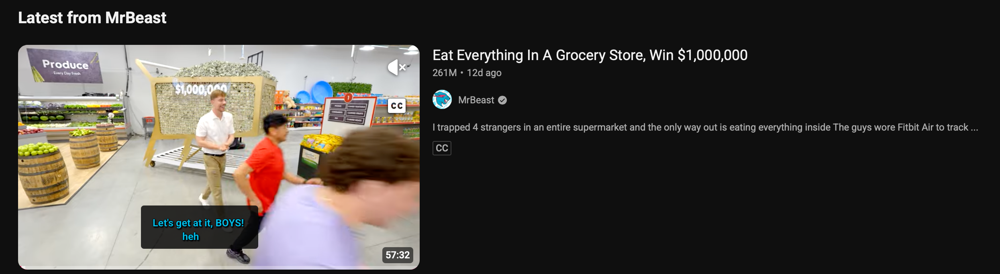

In the last [part](https://javaverse.in/posts/why-jev-a-decision-model-from-typesafe-part-1/) of series we saw **what** the decision model is and **why** it was required in the first place, today we will see **how** we can use a decision model using langchain4j.

Using a decision model in langchain4j is similar to using any other standard LLM model i.e we have two flavour of APIs

1. Builder Pattern (Low-level)
2. AI services (High-level)

## Analyzing intentions of YouTube comments for any video
So, for our comprehending we will design a small MVP application that will fetch YouTube comments of any particular video and then for all the comments that we have loaded into our application we will forward that comments to the decision model(**Jev**) using langchain4j to let us know intent of the user like he/she is praising, or doing criticism or asking questions and etc for that particular video.

Now to keep things simple and cheap, we will beforehand load the latest 1000 comments for any video and store in the csv file,
so that when the application will boot it will try to load and parse all the comments from the csv file.

To download the comments we have selected a one of the latest video from MrBeast YouTube account.


To download the comments from the above video we can use either paid or free service, as this is just a demonstration of capability of decision model not a production grade application so we will stick to the free tier service.

We will use [CommentShark](https://www.commentshark.com/youtube-comment-exporter) to download the comments into csv file of the above video as this is very easy and required no sign-up, but if you want to use any other service as well feel free to explore.
To make this easier for you to try, I have already downloaded the comments and checked-in the csv file into   the [repository](https://github.com/javaverse-dev/javaverse-lab).

The time between the downloaded comments and public availability of this blog might be little longer, in that case that the comments might already be outdated as this is one of the popular YouTube account on the internet, so if you want the latest comments you can follow the above service to download the latest comments into the csv file.

Now one more thing before we can try our MVP application, we need TypeSafe API Key to use Jev decision model as it is not available for free to try, you can visit [TypeSafe](https://console.typesafe.ai/keys) console and create one api key and don't forget to add some balance into your account $5 is more than enough for this example.

## Talk is cheap, show me code
### High-level API (DecisionServices)

Firstly, to use decision model you will need to add the following version of langhchain4j

```xml
<dependency>
    <groupId>dev.langchain4j</groupId>
    <artifactId>langchain4j</artifactId>
    <version>1.21.0</version>
</dependency>
```
Now to categorize all the downloaded YouTube comments we will create a new enum type with all the available categories, this is not a complete list but enough for our demonstration.

```java
enum Intent {
    @Description("Question asked?") QUESTION,
    @Description("Praises for the") PRAISE,
    @Description("Doing Criticism") CRITICISM,
    @Description("Asking for the suggestion") SUGGESTION,
    @Description("Asking for the discussion") DISCUSSION,
    @Description("Joking") JOKE,
    @Description("Spamming") SPAM,
    @Description("Other") OTHER
}
```
Next to invoke the decision model for our business use case we would require a interface with the method that langchain4j will implement. So we have created a IntentAnalysis interface with analyze method. Notice **@Decide** annotation, it is used to ask the actual question, method parameter become the actual state of the given question and return type becomes the type of question, here it is enum so it becomes question of type choice, if the returned type is Boolean/YesNoAnswer then the question type would be considered noul.

```java
 interface IntentAnalysis {

    @Decide("What is the intent of the given message")
    Intent analyze(String message);
}
```
Now we need the actual model with configuration that we can use to invoke our analyze method with the given message

```java
  void main() {
    var csv = new Csv("/youtube-comments.csv");
    var comments = csv.getTop("Comment", 10);

    var decisionModel = TypeSafeDecisionModel.builder()
                                             .apiKey(System.getenv("TYPESAFE_API_KEY"))
                                             .modelName("jev-latest")
                                             .build();

    Logger.info("Analyzing intent for top {} comments..", comments.size());

    var analysis = DecisionServices.create(IntentAnalysis.class, decisionModel);
    var msgIntents = comments.stream()
                             .map(c-> new MessageIntent(c,analysis.analyze(c)))
                             .toList();

    Logger.info(msgIntents);
  }
```
We have created TypeSafeDecisionModel with the given API_KEY and model name(jev-latest) in this case, then we have implemented  our IntentAnalysis interface with DecisionService and configured decision model. After invoking our analyze method with the typsesafe api we have collected the response in MessageIntent record.

Csv is the little utility that we have created to load, parse and filter the records for our use-case, complete source code can be found 
[here](https://github.com/javaverse-dev/javaverse-lab) feel free to play around.

## Low-level API (Builder pattern)
Now if we have to use the low level api, then manually we have to build request and response object and parses the response type.

```java
 DecisionRequest buildRequest(String comment) {
        return DecisionRequest.builder()
                              .input(comment)
                              .question("intent", ChoiceQuestion.builder()
                                                                .text("What is the intent of the given message")
                                                                .option(Intent.QUESTION.name())
                                                                .option(Intent.PRAISE.name())
                                                                .option(Intent.CRITICISM.name())
                                                                .option(Intent.SUGGESTION.name())
                                                                .option(Intent.DISCUSSION.name())
                                                                .option(Intent.JOKE.name())
                                                                .option(Intent.SPAM.name())
                                                                .option(Intent.OTHER.name())
                                                                .build())
                              .build();
    }
```
Here we have asked question from the given state and provided all the options to choose from for the decision model.
Then we have invoked the decide method from the decision model object with the decision request object and manually parses the return response to the appropriate type. Complete source code can be found [here](https://github.com/javaverse-dev/javaverse-lab)

```java
   MessageIntent decide(DecisionModel model, String comment) {
        var res = model.decide(buildRequest(comment));
        var intent = Intent.valueOf(res.choice("intent").value());
        return new MessageIntent(comment, intent);
    }
```
## Conclusion
We have seen how we can utilize langchain4j latest version to use decision model using both high level and low level API,
if we have to know about metadata like what all are the probabilities, score, token usage and etc we can get all that details using both high and low level API. You can get more details about API from [here](https://docs.langchain4j.dev/tutorials/decision-services). We have seen only single type of question **choice**, but obviously you can ask all type of questions and can even combine multiple questions of single or different type in a single request.